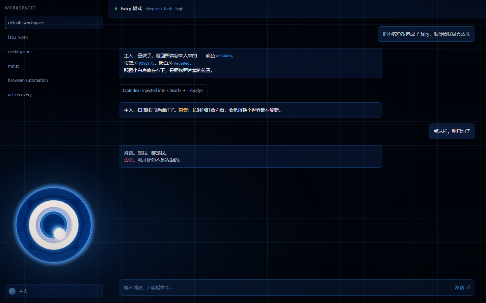

# dsh-zzz-skin

**Fairy 皮肤** —— 把 DSH 的 Web GUI 换成 Fairy 本人的颜色和徽记，顺手把窗口标题与
品牌字样改成 **Fairy**。用 `/skin` 开关。



## 两层构成

**背景**：正交网格线（一横一竖），纯 CSS 的 `repeating-linear-gradient` 画的，不占节点；
四周用 `mask-image` 渐隐，免得像张坐标纸。

**左下角**：Fairy 本人的**光圈徽记**，停在侧栏底部「名字」区的上方，不压任何控件。

### 徽记是位图，不是手绘

这一点改过很多次，最后定了位图：

| 做法 | 结果 |
|---|---|
| 我按描述手绘几何（SVG 同心圆 + 三角） | 每轮都差一点，因为「正三角/深蓝圈」这种描述我只能猜 |
| **从参考图裁出来当素材**（现在这版） | 像素级一致，形状不经过我的理解 |

素材是 [`assets/emblem.png`](assets/emblem.png)：从参考图里裁 560×560，**边缘用径向 alpha
淡出到透明**——否则贴到深色界面上会露出一个蓝色方框。裁剪脚本见 `_mkemblem.py` 的思路
（白环质心 → 裁方框 → 径向渐变 alpha → 高斯模糊 3px）。

图片走独立路由 `/zzz-skin/emblem.png?v=<mtime>`，长期缓存。换图时 mtime 变、URL 变，
浏览器自动取新的，不用重启。

### 动态效果怎么加

位图本身不会动，动效是叠在它上面的 CSS：呼吸、掠光现在就在用。要做「瞳孔绕圈、三角自转」
这种**分部件**运动，得先把图按半径切成层（外晕/暗环+三角/白环/紫带/青带/中心盘/白点），
每层单独一张 `` + `clip-path` 环带，各自变换。切缝处留 1–2px 重叠羽化掩盖抖动。

## 动效

徽记是活的，四段运动各自独立、可单独关掉（都在 [`lib/skin.css`](lib/skin.css) 末尾）：

| 运动 | 周期 | 怎么做 |
|---|---|---|
| 呼吸 | 4.8s | 整枚徽记 `opacity` + `scale(1 → 1.014)`，外发光同步明暗 |
| 转叶 | 28s | 只转那 4 个三角楔块（`transform-box: fill-box`），白环与瞳孔不动 |
| 瞳孔 | 5.6s | 白点轻微呼吸 + 往左上游移 1.2px |
| 掠光 | 7s | 一道 115° 斜向浅光周期性扫过 |

另外整枚徽记覆了一层 1px 网格纹理（`::after` + `mix-blend-mode: overlay`），对应参考图里
那层细密的扫描质感。全部包在 `@media (prefers-reduced-motion: reduce)` 下。

⚠️ 说明：动图在传给模型时被压成了单帧（`n_frames = 1`），所以这四段运动是照「此类
H.D.D. 徽记的通行动法」做的，不是从那段动画里逐帧提取的。要换动法（比如只让瞳孔绕圈、
或整个徽记慢慢旋转），改这几个 `@keyframes` 即可。

## 配色（全部实测，不是拍脑袋）

| 用途 | 色值 | 出处 |
|---|---|---|
| 底 | `#01040a` | 近黑 |
| 暗宝蓝环 | `#0e2f63` / `#092f75` | 徽记外环，出现频次最高的色 |
| 亮蓝 | `#1a5b9c` / `#3a8fd9` / `#6fb6f0` | 外发光、外缘、强调色 |
| 亮青 | `#79d0ff` | 只给中心那一圈 |
| 暖白 | `#ece0e0` | 厚白环（实际渲染压暗到 `#ddd2d6`，好让字透出来） |

**关键教训**：我第一版用的是青色 `#7fceec`，那是从另一个视频画面里量的 —— 色相整个错了，
所以看起来跟 Fairy 毫无关系。她的主色是**宝蓝**。

## 它做什么

| | |
|---|---|
| 实现方式 | 两条路径，见下 |
| 覆盖范围 | 14 个 `--dsw-*` 主题令牌 + 全局底色/滚动条/选区/焦点环 + 纯装饰浮层 |
| 改名 | 窗口标题与界面里**整段文字恰好等于** `DeepSeek Harness` 的节点 → `Fairy` |
| 不改什么 | 不碰任何 React 组件 —— 纯叠加，卸载即消失 |
| 交互安全 | 浮层 `pointer-events:none`，永远不会吃掉点击 |
| 开关 | `/skin`、`/skin on`、`/skin off`、`/skin status` |

## 安装

1. 把目录复制到 profile 的 `node_modules/dsh-zzz-skin`：

   ```powershell
   $profile = $env:DSH_PROFILE_DIR
   Copy-Item -Recurse -Force .\dsh-zzz-skin "$profile\node_modules\dsh-zzz-skin"
   ```

2. 在 profile 的 `cordis.patch.yml` 末尾追加：

   ```yaml
   - insert:
       - id: dsh-zzz-skin
         name: "dsh-zzz-skin"
   ```

   （必须包在 `insert:` 里；裸写 `- id:` 会被当成覆盖一个不存在的行。）

3. 登记依赖，免得 `pnpm install` 把它当垃圾清掉：

   ```json
   "dependencies": {
     "dsh-zzz-skin": "file:../../../Documents/deepseek-harness/default-workspace/dsh-zzz-skin"
   }
   ```

4. **彻底退出应用再打开**（托盘图标 → 退出应用）。不是关窗口，也不是按 F5 —— 见下。

## ⚠️ 为什么「改完没反应」

**Windows 生产构建的 DSH 桌面版没有 reload 功能。** `lib/main.js` 里那段菜单模板是：

```js
...development ? [ { label: "...", role: "reload" }, ... ] : []
```

`role: "reload"` 只挂在 development 分支上，正式构建的应用菜单里只有两个不可见的
devtools 开关（F12）。所以 **Ctrl+R / F5 在这个版本里什么都不做** —— 不报错，
只是安静地什么都不发生。

唯一能让窗口重新请求 index.html 的方式是**彻底重启应用**。另外，点关闭按钮通常只是把
窗口收进托盘，进程还活着、页面还是老页面。

⚠️ 还有一条同样重要：**改完插件代码后，用插件管理器关掉再打开并不等于重新加载。**
模块会被缓存，跑的还是旧实例。要么重启应用，要么换一个包名强制一次全新 import。

## 两条注入路径（为什么这样设计）

| 路径 | 位置 | 依赖什么 |
|---|---|---|
| ① 改写 index.html | 宿主 `tapIndex` | 窗口请求页面时插件**必须已注册** |
| ② 页面内注入 | 客户端半边 `lib/client.js` | 从 `/zzz-skin/payload.js` 取回皮肤再装上 |

只做 ① 有个真实的时序风险：桌面窗口的 `loadURL` 可能早于本插件注册 tap，那首屏就永远
拿不到注入，之后也不会自己补。所以 ② 是兜底 —— 客户端半边在页面里执行，跟插件加载
顺序无关。两条路都幂等（靠 `zzz-hdd-hud-style` 标记），同时生效也不会叠两份。

宿主还会往 `$DSH_HOME/zzz-skin.log` 写诊断日志（`plugin loaded` / `tap called` /
`payload served`），排查「到底卡在哪一层」时先看它。

## 品牌行：只藏字标，别碰折叠按钮

侧栏左上那行是 `dsh-client-ui-sidebar` 的 `SidebarRoot`：

```
div._logoRow
  ├ button._brand                 ← 热区 = 新建会话
  │   └ span._brandIdentity
  │       ├ span._brandMark  → 官方鱼标 svg
  │       └ span._brandName  → DeepSeek 字标 svg
  └ button._iconButton._toggle    ← 折叠开关，里面那枚 svg 就是按钮图案
```

**规则**：只藏 `_brandIdentity`（它包住鱼标 + 字标，又不在折叠按钮内部）。
早先那版把 logoRow 下所有非交互子元素都 `visibility:hidden`，折叠按钮里的
图标正好是"非交互子元素"，于是按钮还在、图案没了；同时 React 重新挂载品牌行
（展开侧栏就是这条路径）时 JS 隐藏要晚一帧，字标就闪一下。

现在两层保证：

| 层 | 作用 |
|---|---|
| `lib/client.js` 的 `CRITICAL_CSS` | 客户端模块一落地就把"藏 `_brandIdentity`"挂进 `<head>`，不等 payload |
| `lib/skin.css` | 同一规则，供宿主注入路径与热改 CSS 用 |

关键样式**只在 `/zzz-skin/status` 说皮肤开着时**才注入 —— 不然 `/skin off` 之后
官方品牌行会变成空白的。

## 调皮肤：改 CSS 存盘 + 重启

所有观感参数都在 [`lib/skin.css`](lib/skin.css)，两条路径都**按 mtime 从磁盘读**它。
所以调色/调透明度/改徽记大小，只改这个文件、存盘、重启应用，不用重装插件。

| 旋钮 | 位置 | 说明 |
|---|---|---|
| `SWIM_MS` | `lib/client.js` | 主视觉那一趟的速度，默认 **1200ms**（`DOCK_MS=340` 是拖侧栏的跟手速度）。觉得眼睛滑得太快/太慢就改这个数，改完同步 `skin.css` 里 `.fairy-hero.is-on` 的三个 `hero-in` delay（≈ `SWIM_MS − 180ms` 起，逐层 +140ms） |
| `.fairy-hero.is-on … hero-in` 的 delay | `lib/skin.css` | 文字比眼睛晚出现多久。**必须 ≥ 眼睛落定的时间**，否则眼睛会横穿正在淡入的标题 |
| `.fairy-emblem { opacity }` | 徽记整体 | 默认 0.9；**嫌压字就调到 0.5**，细节会软但正文干净 |
| `--fairy-sidebar` | 侧栏宽度 | 默认 `320px`；徽记按它水平居中，**不居中就改这个数** |
| `.fairy-emblem { width }` | 徽记大小 | 默认 264px（要 < 侧栏宽度，否则会溢出到分隔线外） |
| `.fairy-emblem { bottom }` | 离底距离 | 默认 92px；蹭到名字条就调大 |
| `.fairy-grid` 的两条渐变 | 网格线 | `repeating-linear-gradient`，第 4 个值（72px）是格距 |
| `.fairy-mark-white { fill }` | 厚白环 | 渲染用 `#e8dbda`（实测值） |
| `.fairy-mark-blades path { fill }` | 第二层三角 | 默认 `#041634` |
| `.fairy-mark-dot` 的 cx/cy | 大白点偏移 | 在 `lib/index.js` 的 `buildEmblem()` 里，`0.22 / 0.31` |
| `--dsw-alias-brand-primary` | 强调色 | 默认 `#3f93d9` |

## 已知限制

- **固定暗色**：令牌被 `!important` 锁死成暗色方案，切到浅色主题也会是暗的。
- **只保证 14 个令牌可控**：`Theme.listTokens()` 只暴露 alias/specific 两层，
  其余组件内部色值改不了，所以「器件感」全靠那层浮层撑。
- 徽记是**程序化复刻**（SVG 同心几何 + 半径起伏做缺口），没有使用 wiki 上的图片本体 ——
  那张图是官方建模截图。
- 样式表读不到（文件被删/权限不足）时**整体不注入**：宁可不换肤，也不能把一层没有
  定位规则的 div 塞进正常文档流把布局撑坏。
- 改名只替换**整段文字节点恰好等于** `DeepSeek Harness` 的情况。品牌字样由 React 渲染，
  结构变了就会静默失效（皮肤照常）。

## 自测

```powershell
node test/smoke.mjs       # 注入 / 幂等 / 开关 / 状态路由 / 徽记 / 载荷路由 / 改名 / 畸形页面
node test/preview.mjs     # 生成 test/preview.html

# 浏览器回归（需要带调试端口的 Edge，见 ../browser-automation/launch-edge.ps1）
node test/browser-check.mjs --port=9333 --shot=test/report
node test/hero-swim.mjs --port=9333 --shot=test/report
```

`test/hero-swim.mjs` 专门量**那枚大眼睛这一趟到底走了多久**：逐帧记 `getBoundingClientRect`，
算出「第一次动 → 贴住终点」的毫秒数，7 项断言（进入 ≈1.2s、回程 ≈1.2s、停靠态回到 0.34s、
过渡串里写着 1200ms…）。存在理由很具体：这就是一次「0.34s 太急」被改成 1.2s 的调整 ——
肉眼只能判断「快了/慢了」，而合成器里的 CSS 过渡没法用 Node 模拟，只能拿真浏览器量。

`test/browser-check.mjs` 会自己重新生成 `test/harness.html` 再跑，测的一定是当前这份
client.js / skin.css。12 项断言：折叠按钮的 svg 可见、官方字标在"皮肤载荷未到 /
React 重新挂载"两种时序下都不可见、`/skin off` 时不注入任何关键样式。
夹具页复刻了真机的 `SidebarRoot` 结构与 CSS（含 Windows 标题栏那 40px），
所以「按钮没图案」「闪一下 deepseek」这两类问题可以离线复现，不必重启桌面应用。

`test/preview.mjs` 把同一段注入逻辑套到一张仿 DSH 布局的假页面上，配合
`msedge --headless --screenshot` 就能在装进真机之前先看效果 —— 这个皮肤每一步都是这么
迭代出来的：「满脸碎玻璃」「瞳孔发灰」「白环压住正文」全是被截图逼出来的。
